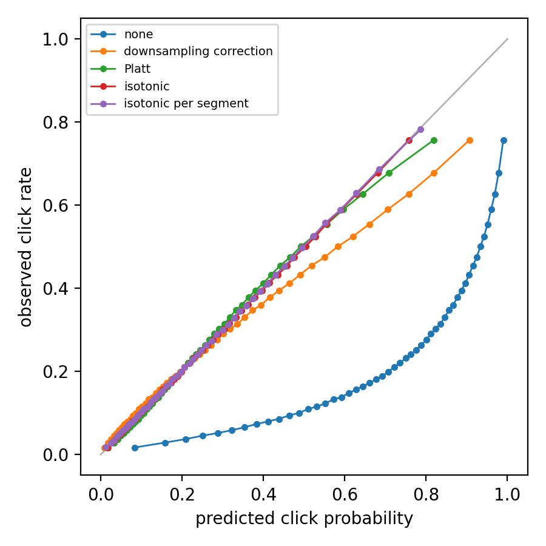

# Calibrating a click-through-rate model

An ad-ranking model predicts the probability that an ad is clicked. To train it cheaply, the
non-clicks are usually downsampled - here to 10% - which leaves the model's probabilities far
too high. Before they can be used to price ads or to compare with real click rates, they are
calibrated on held-out traffic: one monotone curve maps every score to the click rate observed
at that score. Isotonic regression fits that curve; it is what scikit-learn's
`CalibratedClassifierCV(method="isotonic")` does.

[`calibrate.py`](calibrate.py) does it end to end on the
[Criteo Display Advertising Challenge](https://www.kaggle.com/datasets/mrkmakr/criteo-dataset)
data: 45.8 million impressions over seven days, split into seven equal parts in time order.

1. A logistic regression with hashed features is trained on days 1-5, with 10% of the
   non-clicks.
2. Its scores on day 6 calibrate it, in four ways: the analytic correction for the
   downsampling, Platt scaling, one isotonic regression over the whole day, and one per
   segment - the frequent values of a categorical feature, which the script picks. The two
   isotonic fits run with scikit-learn on the CPU and with torchisotonic on the GPU, and must
   give the same curves.
3. Day 7 measures each: log-loss, Brier score, expected calibration error, and a reliability
   diagram.
4. Isotonic calibration is timed on growing numbers of scores, up to all 45.8 million.

The per-segment fit is a single call: the scores are keyed by segment plus score, and each
segment's click rates are offset by twice its index, so that no block of the fit can reach
across a segment boundary. One long problem, rather than a batch of rows of unequal length.

```bash
pip install torchisotonic scikit-learn pyarrow matplotlib
python examples/ctr_calibration/calibrate.py --data path/to/dac/train.txt --out results/
```

It needs about 8 GB of memory for the data and as much on the GPU. `--rows` takes only the
first rows, for a quick try. On Kaggle, `kaggle/push.sh example-ctr` runs it with the dataset
attached.

This folder is not part of the installed package.

## Results

On a Kaggle T4 (and its CPU for scikit-learn), all 45.8 million rows, with the seed the script
sets. The model reaches an AUC of 0.767 on day 7; trained with a tenth of the non-clicks, it
predicts a mean click probability of 0.67 for a click rate of 0.26.

| calibration (fit on day 6) | log-loss | Brier | ECE | mean p | CTR |
| --- | ---: | ---: | ---: | ---: | ---: |
| none | 0.9837 | 0.3433 | 0.4148 | 0.6745 | 0.2597 |
| downsampling correction | 0.4890 | 0.1605 | 0.0316 | 0.2800 | 0.2597 |
| Platt | 0.4822 | 0.1581 | 0.0080 | 0.2592 | 0.2597 |
| isotonic | 0.4817 | 0.1580 | 0.0015 | 0.2592 | 0.2597 |
| isotonic per segment | 0.4809 | 0.1573 | 0.0024 | 0.2575 | 0.2597 |

The analytic correction undoes the downsampling only on average; a monotone curve fitted to
the data removes the rest, and does better than Platt scaling: by 5.0e-4 in log-loss over day 7
(95% interval 4.7e-4 to 5.3e-4, paired over the rows). Per segment (the 280 values of C15 with
at least 5,000 rows on day 6, 60% of the traffic), one curve per segment lowers the log-loss of
those rows from 0.4764 to 0.4752, by 1.24e-3 (95% interval 1.07e-3 to 1.42e-3).



The isotonic fits agree with scikit-learn's to 6e-16 (one curve) and 7e-10 (per segment, where
scores are keyed as segment + score in float64). The GPU times include sorting the scores and
pooling equal ones; "from host memory" also copies the scores and labels to the GPU first, as
scikit-learn's start there:

| fit | scores | scikit-learn (CPU) | torchisotonic (GPU) | from host memory |
| --- | ---: | ---: | ---: | ---: |
| one curve, day 6 | 6,548,660 | 1.94 s | 0.038 s | 0.057 s |
| 280 curves, day 6 | 3,950,507 | 7.28 s | 0.033 s | - |
| one curve | 100,000 | 0.023 s | 0.0008 s | 0.0014 s |
| one curve | 1,000,000 | 0.24 s | 0.0044 s | 0.0078 s |
| one curve | 10,000,000 | 3.16 s | 0.038 s | 0.071 s |
| one curve, all days | 45,840,617 | 16.8 s | 0.155 s | 0.310 s |
